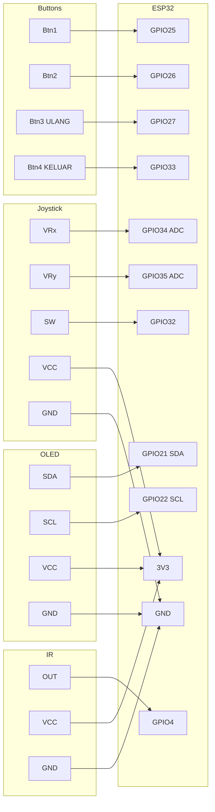

# ESP32 BLE Gamepad / Keyboard Combo

ESP32 project yang berfungsi sebagai **Bluetooth LE Keyboard+Mouse** atau **BLE Gamepad**, bisa diganti lewat menu di OLED SSD1306 128x32.

Fitur utama:
- Dual mode: **KEYBOARD** (joystick = mouse, tombol + IR remote = key) / **GAMEPAD** (joystick = left stick, tombol + IR = button/D-pad)
- Mapping tersimpan terpisah per mode (Preferences / NVS)
- Menu konfigurasi via joystick + tombol (tahan SW saat boot, atau tahan GPIO27+GPIO33 2 detik)
- Support remote IR (VS1838B / TSOP) untuk mapping tombol tambahan
- Animasi rain / bitmap di OLED saat idle

## File

| File | Keterangan |
|------|------------|
| `esp32_ble_gamepad.ino` | Sketch utama |
| `hid_pad.h` / `hid_pad.cpp` | Wrapper ESP32-BLE-Gamepad (dipisah agar tidak conflict dengan BleCombo/Bluedroid) |

## Library yang dibutuhkan

1. **ESP32-BLE-Combo** (keyboard + mouse BLE) – gunakan versi yang compatible dengan Bluedroid
2. **ESP32-BLE-Gamepad** by [lemmingDev](https://github.com/lemmingDev/ESP32-BLE-Gamepad) + **NimBLE-Arduino** (hanya jika `ENABLE_GAMEPAD_MODE = 1`)
3. Adafruit SSD1306 + Adafruit GFX
4. IRremote ≥ 4.4 (Armin Joachimsmeyer)

**Partition Scheme:** `Huge APP (3MB No OTA / 1MB SPIFFS)` — dua stack BLE + IRremote cukup besar.

> Kalau tidak butuh mode gamepad, set `#define ENABLE_GAMEPAD_MODE 0` di `hid_pad.h`. Library gamepad & NimBLE tidak diperlukan lagi.

### Catatan perbaikan library ESP32-BLE-Gamepad / NimBLE

Referensi perbaikan umum yang sering dibutuhkan (reconnect Windows, VID/PID, dll):

- Issue reconnect input hanya bekerja saat first pair (Windows):  
  https://github.com/lemmingDev/ESP32-BLE-Gamepad/issues/251  
  dan workaround terkait NimBLE: https://github.com/h2zero/NimBLE-Arduino/issues/850
- VID/PID byte-order fix setelah NimBLE 1.4.2+:  
  https://github.com/lemmingDev/ESP32-BLE-Gamepad/issues/229
- Official repo & troubleshooting:  
  https://github.com/lemmingDev/ESP32-BLE-Gamepad  
  https://github.com/lemmingDev/ESP32-BLE-Gamepad/blob/master/TroubleshootingGuide.md

Wrapper `hid_pad.cpp` sudah memakai `setAutoReport(false)` + `sendReport()` manual, dan hanya include BleGamepad di file terpisah agar tidak bentrok dengan BleCombo.

> Link share Claude agent yang disebutkan user (`https://claude.ai/share/52bcc740-f05a-46ef-87d0-75b22784545c`) tidak bisa diakses dari sisi agent (Cloudflare challenge). Jika ada patch spesifik dari percakapan tersebut, silakan kirim ulang isinya agar bisa digabungkan.

## Wiring

```
ESP32 DevKit
─────────────────────────────
Joystick (analog):
  VCC  → 3V3
  GND  → GND
  VRx  → GPIO34 (ADC)
  VRy  → GPIO35 (ADC)
  SW   → GPIO32 (INPUT_PULLUP)

Push button (active LOW ke GND):
  Button 1 → GPIO25
  Button 2 → GPIO26
  Button 3 → GPIO27   (menu: ULANG)
  Button 4 → GPIO33   (menu: KELUAR)

OLED SSD1306 128x32 (I2C):
  SDA → GPIO21
  SCL → GPIO22
  VCC → 3V3
  GND → GND

IR Receiver (VS1838B / TSOP1838):
  OUT → GPIO4
  VCC → 3V3
  GND → GND
```

### Diagram wiring (ASCII)

```
                    ┌─────────────────┐
                    │   ESP32 DevKit  │
                    │                 │
   Joystick VRx ────┤ GPIO34          │
   Joystick VRy ────┤ GPIO35          │
   Joystick SW  ────┤ GPIO32          │
   Button 1     ────┤ GPIO25          │
   Button 2     ────┤ GPIO26          │
   Button 3     ────┤ GPIO27          │
   Button 4     ────┤ GPIO33          │
   OLED SDA     ────┤ GPIO21          │
   OLED SCL     ────┤ GPIO22          │
   IR OUT       ────┤ GPIO4           │
                    │                 │
   3V3 ─────────────┤ 3V3             │
   GND ─────────────┤ GND             │
                    └─────────────────┘
```

### Mermaid wiring diagram



## Cara masuk menu konfigurasi

1. Tahan **joystick SW** saat ESP32 dinyalakan / di-reset, **atau**
2. Tahan **GPIO27 + GPIO33** bersamaan selama ±2 detik.

Navigasi menu:
- Joystick atas/bawah = pilih
- Klik joystick = OK
- GPIO33 = keluar

Menu yang tersedia:
- **Mapping tombol** → tekan pushbutton / remote IR → pilih key di layout → tersimpan
- **Mode** → ganti KEYBOARD ↔ GAMEPAD (restart otomatis setelah keluar menu)
- **Reset mapping** → kembalikan mapping mode yang aktif ke default
- **Keluar**

## Build & Upload

1. Install library di atas via Library Manager / PlatformIO.
2. Pilih board ESP32 + partition **Huge APP**.
3. Upload sketch.
4. Pair device di PC / Android / iOS sebagai keyboard atau gamepad sesuai mode yang aktif.

## Lisensi

Kode sketch ini bebas digunakan / dimodifikasi.  
Library pihak ketiga mengikuti lisensi masing-masing (ESP32-BLE-Gamepad = MIT, dll).

---
Dibuat dari project ESP32 BLE Gamepad v3.
